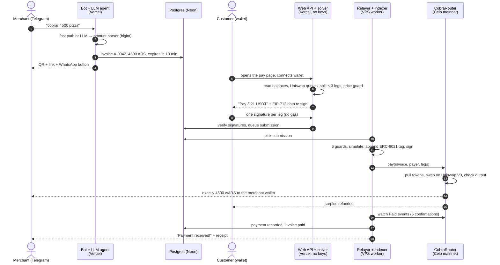
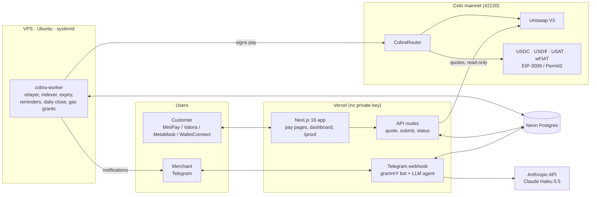

# Cobrá

**Get paid in your own currency with a QR code, straight into your wallet.**

Cobrá is a checkout for Latin American merchants on **Celo mainnet**. The merchant types `cobrar 4500 pizza` on
Telegram and gets a QR code. The customer scans it, pays with the stablecoins they hold (USDC, USD₮, USAT…) and
**signs once, with no gas**. The merchant receives **exactly 4 500 pesos in wARS** (or reais in wBRL) in their own
wallet a few seconds later.

| Try it | |
| --- | --- |
| Telegram bot (merchant) | [@cobra_agent_telegram_bot](https://t.me/cobra_agent_telegram_bot) |
| Web app (payer pages, live proof of payments) | https://cobra-beige.vercel.app |
| Payment router (immutable contract, Uniswap V3 + Textile FX RFQ) | [`0x5658…7069`](https://celoscan.io/address/0x5658505fc0632269e024893a7448a3b5070d7069) (v2, live) · [`0xfe38…e458`](https://celoscan.io/address/0xfe38683105fa36ee664acefe7e714ba93492e458) (v1, still indexed) |
| Agent identity (ERC-8004) | [agent #10033 on 8004scan](https://8004scan.io/agents/celo/10033), wallet [`0x9E82…ccd5`](https://celoscan.io/address/0x9E828B877EFCdb79B507fF6234d841A8265Cccd5) |

---

## Contents

1. [Why Cobrá](#why-cobrá)
2. [Merchant guide: start getting paid](#merchant-guide-start-getting-paid)
3. [Customer guide: pay a Cobrá QR](#customer-guide-pay-a-cobrá-qr)
4. [The agent's journey, step by step](#the-agents-journey-step-by-step)
5. [Tech stack and infrastructure](#tech-stack-and-infrastructure)
6. [Celo building blocks](#celo-building-blocks)
7. [Security: why nobody can redirect the money](#security-why-nobody-can-redirect-the-money)
8. [Coverage and fees (measured)](#coverage-and-fees-measured)
9. [For developers](#for-developers)
10. [Deployment](#deployment)
11. [Known limitations](#known-limitations)

---

## Why Cobrá

A small shop in Buenos Aires or São Paulo wants to accept crypto, but:

- its customers hold **dollars** (USDC, USD₮), while the shop thinks, prices and pays rent in **pesos or reais**;
- customers rarely hold **CELO** to pay network fees;
- the shop doesn't want to manage a payment terminal, an exchange account or a complicated dashboard.

Cobrá solves the three at once:

| For the merchant | For the customer |
| --- | --- |
| Everything happens in a Telegram chat, in Spanish, Portuguese or English | Scan, connect your wallet, tap **Pay**: one signature |
| Receives the **exact** amount asked, in a local-currency stablecoin (wARS, wBRL…) | Pays with whatever stablecoins they hold, split across up to 3 tokens if needed |
| Money goes **directly to their own wallet**: Cobrá never holds it | **No CELO needed**: Cobrá pays the network fee |
| No fees taken by Cobrá, no contract owner, no upgrade path | Any surplus from the swap is refunded in the same transaction |

---

## Merchant guide: start getting paid

Setup takes about one minute. You need two things:

- **Telegram** (phone or desktop);
- **a wallet address on Celo** where you want to receive the money, for example from
  [MiniPay](https://www.opera.com/products/minipay), [Valora](https://valora.xyz) or MetaMask with the Celo network.
  You only share the **public address** (`0x…`). You don't need CELO, and Cobrá never asks for a private key or a seed
  phrase.

### Step 1: open the bot and pick your country

1. Open [@cobra_agent_telegram_bot](https://t.me/cobra_agent_telegram_bot) and tap **Start** (or send `/start`).
2. The bot asks: *"Step 1 of 2: in which country is your business?"*. Tap your country. You can also switch the
   language (Español / Português / English) with the buttons under the list.

   | Country | You receive | Your customers can pay with |
   | --- | --- | --- |
   | 🇦🇷 Argentina | **wARS** (1 wARS = 1 peso) | USD₮, USDC, USAT, wARS |
   | 🇧🇷 Brazil | **wBRL** (1 wBRL = 1 real) | USD₮, USDC, USAT, wBRL (≈ 0.7 % through Textile FX, ≈ 3.3 % when only Uniswap quotes; see [fees](#coverage-and-fees-measured)) |
   | 🇲🇽 Mexico, 🇨🇴 Colombia | wMXN, wCOP | the same wFIAT only; the payment page offers to buy it in pesos through Ripio |
   | 🇨🇱 Chile, 🇵🇪 Peru | wCLP, wPEN | the same wFIAT only |

### Step 2: paste your wallet address

3. The bot asks: *"Step 2 of 2: paste your Celo wallet address (starts with 0x)"*. Copy it from your wallet and paste it.
   - The address is checked (format, checksum, not a token contract or the zero address).
   - If you paste something that looks like a private key or a seed phrase by mistake, the bot refuses it and tells you
     how to protect your funds.
4. Done. The bot replies with:
   - a confirmation: *"You'll receive wARS at 0x…"*;
   - **your fixed QR code**: print it and stick it at the counter. Customers scan it and type the amount themselves.

### Step 3: charge a customer

Write the amount and what it's for:

```
cobrar 4500 pizza
```

The bot answers in a second with a **QR code**, the **payment link** and three buttons:
**Share on WhatsApp** (pre-written message), **Open payment link**, **Cancel**.
Show the QR on your phone, or send the link to a remote customer.

- The payment request is valid for **10 minutes**. If it's still unpaid 3 minutes before it expires, the bot reminds
  you, with a WhatsApp link to resend it.
- Amounts are written the way you write them locally: `4500`, `4.500,50`, `2 mil`, `$4500`. If an amount is ambiguous
  (`4.500` vs `4,50`), the bot asks instead of guessing. The bot only charges in your local currency.
- `/cobrar`, `cobrá` and `charge` work too.

### Step 4: get paid

When the customer pays, you get a Telegram message within seconds:

> **Payment received!** A-0042: 4 500 ARS → 4 500.00 wARS in your wallet.
> Receipt: https://celoscan.io/tx/0x…

The money is already in **your** wallet. Cobrá never had it.

### Everyday commands

| Command (es / pt / en) | What it does |
| --- | --- |
| `/cobrar 4500 café` · `/charge` | Create a payment request with QR and link |
| `/facturas` · `/faturas` · `/invoices` | Your last 10 payment requests and their status (pending, paid, expired, cancelled) |
| `/cierre` · `/fechamento` · `/close` | Today's summary (amount collected, number of payments, pending, expired) + a CSV file. Also sent **automatically every evening at 21:00** your local time |
| `/panel` · `/painel` · `/dashboard` | A private link (valid 15 minutes) to your web dashboard: totals, open requests, every payment with its transaction, CSV export |
| `/retirar` · `/sacar` · `/withdraw` | How to cash out to your bank: a prefilled Ripio off-ramp link, and you send from your own wallet |
| `/idioma` · `/language` | Change language |
| `/ayuda` · `/ajuda` · `/help` | List of commands |

You can also just **write normally** (or send a voice note up to 60 s, when speech-to-text is enabled):

- *"¿me pagaron el A-0042?"* → status of that payment, with the Celoscan link;
- *"cancela el último cobro"* → cancels the last open request;
- *"cobrale 12 mil a Juan por el corte"* → creates the request;
- *"quiero recibir en 0xABC…"* → proposes a new payout address. Nothing changes until you tap **Yes, confirm** under the
  message (valid 10 minutes).

The assistant can create, list, cancel, summarise and explain. It **cannot send or move money**: no such action exists.

---

## Customer guide: pay a Cobrá QR

You need a wallet on Celo that holds **USDC, USD₮ or USAT** (or the merchant's local stablecoin, such as wARS).
[MiniPay](https://www.opera.com/products/minipay) and Valora work from their built-in browser; MetaMask and any
[WalletConnect](https://walletconnect.com) wallet work too. **You don't need CELO for fees.**

1. **Scan the QR** with your phone camera (or open the link the merchant sent you). The page shows the merchant's name,
   the amount in local currency (for example `4 500 ARS`), what it's for, the address that will receive the money and a
   countdown (10 minutes).
   - With the merchant's *fixed* QR, you first type the amount yourself, then you land on the same page.
2. **Connect your wallet.** In MiniPay this happens automatically. Otherwise tap **Connect**, or **WalletConnect** to
   use a wallet on another device. If your wallet is on another network, tap **Switch to Celo**.
3. **Check the amount.** Cobrá reads your balances and computes the best route by itself. The button shows exactly
   what will leave your wallet, for example **Pay 3.21 USD₮**, or **Pay 2.00 USDC + 1.21 USD₮** if no single token
   is enough. Above it, the receipt shows the rate you get (for example `1 USD ≈ 1 659.09 ARS`), the total cost
   against the reference rate (for example `0.68 %`) and the network fee (free: Cobrá pays it). The quote refreshes by
   itself before it expires.
4. **Tap Pay and confirm in your wallet.** You sign a message (one per token used). It's a signature, not a
   transaction: no gas, nothing to approve.
5. **Done.** The page shows *Paying…* and then **✓ Paid**, with a Celoscan link. The merchant gets notified at the same
   moment. If the swap returns a bit more than needed, the surplus goes back to you in the same transaction.

**Special cases, all handled on the page:**

- **Paying with a local stablecoin (wARS, wBRL…) for the first time:** these tokens need a one-time authorisation
  (**Authorize wARS**), which is a small transaction. If you have no CELO, Cobrá's agent sends you 0.05 CELO first
  (once per address); the button shows *Preparing…* in the meantime. After that, every payment is a gasless signature.
- **Not enough balance:** the page offers **Pay in pesos** (or reais), which opens Ripio's on-ramp prefilled with the
  country, token, amount and your wallet. Buy, come back, tap **Try again**.
- **Expired or already paid:** the page says so. Ask the merchant for a new QR.

---

## The agent's journey, step by step

Cobrá's agent is an on-chain identity ([ERC-8004 #10033](https://8004scan.io/agents/celo/10033)) backed by one
wallet, plus the software around it. The principle: **the language model understands and explains, deterministic code
computes and executes.** No amount is ever computed by the model, and no key is reachable from it.



| # | Stage | Who | What happens | Guard rails |
| --- | --- | --- | --- | --- |
| 1 | **Understand** | Bot (`packages/bot`) | `cobrar 4500 pizza` matches a regex fast path (no LLM call). Free text and voice notes go to the agent (Claude Haiku 5.5 through the Vercel AI SDK) with 7 tools: create, list, status, cancel, daily summary, withdraw link, preferences | Tools are bound to the Telegram user id; the model passes the amount **as text**, parsed by `amount.ts`; no tool can move funds; a call to an unknown tool discards the whole turn |
| 2 | **Invoice** | Bot → Postgres | Invoice `A-0042` with a 10-minute lifetime, QR rendered as PNG | Rate limit per merchant; the merchant's payout address and token are read from the database, never from the chat |
| 3 | **Quote** | Web API + solver (`packages/solver`) | Reads the payer's balances, asks Uniswap QuoterV2, picks the cheapest route and splits across up to 3 tokens, builds the EIP-712 data | Price guard against reference FX rates (dólar cripto for ARS, AwesomeAPI for BRL); USD caps |
| 4 | **Sign** | Customer | One EIP-712 signature per leg (EIP-3009 or Permit2) | The signature commits to merchant, amount, token, path and split |
| 5 | **Queue** | Web API | Verifies the signatures and stores a `pending` submission | Vercel holds **no private key** |
| 6 | **Relay** | Worker on the VPS (`packages/relayer`) | Picks the submission, simulates, signs and broadcasts `CobraRouter.pay`, tagged ERC-8021 | Single signing module, 5 checks in order: target is the router, calldata decodes as `pay`, kill switch off, USD caps (per payment, per day, per merchant, per payer), no self-payment. Hash saved before broadcast, so a restart never double-sends |
| 7 | **Settle** | CobraRouter (on-chain) | Pulls the tokens, swaps through Uniswap V3, pays the merchant **exactly** the invoice amount, refunds the surplus, emits `Paid` | `InsufficientOutput` revert; each invoice can be paid once |
| 8 | **Confirm** | Indexer (`packages/indexer`) | Reads `Paid` logs after 5 confirmations, reconciles them with the invoice, marks it paid | Restart-safe cursor; mismatches raise an operator alert |
| 9 | **Notify** | Notification outbox | Telegram message to the merchant: amount, wFIAT received, Celoscan link | Sent once per payment |
| 10 | **Follow up** | Worker schedulers | Reminders 3 min before expiry, expiry, daily close at 21:00 local time, gas grants for first-time wFIAT payers | Each one claimed atomically in the database, so it runs once even after a restart |

The agent's public trail: its [agent card](https://cobra-beige.vercel.app/.well-known/agent-registration.json), its
[8004scan page](https://8004scan.io/agents/celo/10033), and the [`/proof`](https://cobra-beige.vercel.app/proof)
page, which lists the payments it relayed. Every transaction it sends carries the ERC-8021 tag `celo_502e1bea2794`.

---

## Tech stack and infrastructure



| Layer | Technology | Where it runs |
| --- | --- | --- |
| Smart contract | Solidity 0.8, **Foundry** (unit, invariant and mainnet-fork tests) | Celo mainnet: `CobraRouter`, immutable, no owner |
| Web app | **Next.js 16**, React 19, **wagmi 3** + **viem 2**, WalletConnect | Vercel |
| Merchant bot | **grammY** (Telegram webhook), **Vercel AI SDK** + Anthropic (Claude Haiku 5.5), zod, `qrcode`; optional Whisper on Groq for voice notes | Vercel (same deployment as the web app) |
| Routing | `packages/solver`: Uniswap V3 QuoterV2, path codec, split across up to 3 legs, FX reference rates | Vercel API routes |
| Relayer, indexer, schedulers | Node 24 + tsx, viem, `@celo/attribution-tags` | VPS, one systemd service |
| Database | **Postgres on Neon**, **Drizzle ORM**; PGlite for tests | Neon |
| Tooling | TypeScript ESM, **pnpm** workspaces, **Vitest**, anvil | Local + GitHub Actions |

**Why a VPS?** Vercel functions are short-lived and shouldn't hold a key. The worker is a long-running process that
polls the queue every 2 s, follows the chain and runs the schedulers. It is the **only place the relayer key exists**:

- `/etc/cobra/worker.env`, owned `root:cobra`, mode `0640`; code read-only in `/opt/cobra`, run as the system user
  `cobra`;
- hardened systemd unit (`apps/worker/deploy/cobra-worker.service`): `ProtectSystem=strict`, `NoNewPrivileges`,
  no capabilities, `PrivateDevices`, core dumps disabled (they could contain the key), graceful shutdown that saves
  in-flight transactions;
- refuses to start (exit 78, no restart loop) if a variable is missing or the RPC isn't Celo mainnet;
- alerts the operator on Telegram (low gas, broadcast errors, unmatched payments); `journalctl -u cobra-worker -f`
  for JSON logs;
- emergency stop without redeploying: set the database flag `kill_switch`.

---

## Celo building blocks

| Piece | How Cobrá uses it |
| --- | --- |
| **wARS, wBRL** (Ripio LatamStable; wMXN, wCOP, wCLP, wPEN also in the registry) | What the merchant receives, 1:1 with the local currency |
| **EIP-3009** (`receiveWithAuthorization`) | Gasless pulls from USDC, USD₮, USAT |
| **Permit2** (witness transfer) | Gasless pulls from wFIAT, which have `permit` but not EIP-3009 |
| **Uniswap V3** (SwapRouter02, QuoterV2) | Swaps and quotes |
| **ERC-8004** | On-chain identity of the agent wallet: agent #10033 (`scripts/agent/register.ts`) |
| **ERC-8021** | Attribution tag `celo_502e1bea2794` on every `pay` call, the router deployment and gas grants |
| **Fee abstraction** | When the payer sends the transaction (fallback mode), gas is paid in a stablecoin |
| **Ripio ramp** | Prefilled on-ramp (pay in pesos/reais) for payers, off-ramp (to the bank) for merchants |

Verified addresses and token capabilities: [`docs/research/onchain-verification.md`](docs/research/onchain-verification.md).

---

## Security: why nobody can redirect the money

Spec: [`docs/interfaces.md`](docs/interfaces.md) §3, code in `packages/shared/src/eip712.ts`, Solidity in
`contracts/src/CobraRouter.sol`.

- The payer signs a `PaymentIntent` (EIP-712): the `Invoice` (id, merchant, tokenOut, amountOut, deadline), the payer,
  and for each leg the token, `amountIn`, pull kind and `keccak256(path)`.
- **EIP-3009 legs** (USDC, USD₮, USAT): `receiveWithAuthorization` has `to = router` and
  `nonce = keccak256(abi.encode(intentDigest, legIndex))`, recomputed on-chain by the router. The token only accepts it
  from the router, and only for that exact intent.
- **Permit2 legs** (wFIAT): `permitWitnessTransferFrom` with `spender = router` and the `PaymentIntent` as witness.
- **Allowance legs** (fallback): the payer sends the transaction themselves.
- Result: the relayer can submit the exact intent or nothing. Changing the merchant, amount, token, path or split
  invalidates the signature. The router checks the total output (`InsufficientOutput`), and `isPaid` is keyed by the
  invoice hash, so replays and front-running pay once.
- The router has **no owner, no fee, no upgrade path, no sweep**. Solidity and TypeScript share test vectors
  (`contracts/test/vectors/eip712.json`). Self-review: [`contracts/SECURITY.md`](contracts/SECURITY.md) (not an audit).
- Off-chain caps (defaults): 200 USD per payment, 2 000 USD per day in total, 500 USD per day per merchant and per payer.

---

## Coverage and fees (measured)

Read-only measurements on Celo mainnet, 2026-11-03. Data: `docs/research/plan3/coverage-matrix.json`, report:
`docs/research/plan3/fees-report.md`.

| Country | Token | Route | Total cost at 5 / 50 / 500 / 5000 USD | Status |
| --- | --- | --- | --- | --- |
| Argentina | wARS | USD₮ → wARS (Uniswap V3, 0.01 %) | 0.19 / 0.08 / 0.09 / 0.36 % | Supported |
| Argentina | wARS | USDC → USD₮ → wARS | 0.23 / 0.09 / 0.10 / 0.38 % | Supported |
| Brazil | wBRL | USD₮ → wBRL (Textile FX RFQ, router v2) | 0.68 % measured on a real 8 BRL payment (2026-11-04); other sizes depend on the fillers' quotes | Supported |
| Brazil | wBRL | USD₮ → wBRL (Uniswap V3, fallback) | 3.40 / 3.30 / 3.40 % / refused above 500 USD | Fallback only (pool priced ~3.3 % above market) |
| Mexico, Colombia | wMXN, wCOP | pay in the same wFIAT, or buy it in pesos through Ripio | no swap: network fee only | Direct payment |
| Chile, Peru | wCLP, wPEN | pay in the same wFIAT only (no Ripio ramp, no pool) | no swap: network fee only | Limited |

Total cost = relayer gas (about 0.007 USD per payment, paid by Cobrá) + pool fee + price impact + deviation from the
reference rate (dólar cripto for ARS, AwesomeAPI for BRL). On-ramp and off-ramp costs are not included. wARS follows the
crypto dollar rate, not the official ARS rate. Liquidity can move: payments are capped and the solver refuses quotes
beyond its price guard.

---

## Paid FX quote over x402 (experimental)

`GET /api/x402/fx-quote?currency=ARS&amount=4500` (ARS or BRL) tells an agent what it costs, in USD₮ and in USDC, to
deliver exactly that amount of wARS or wBRL on Celo through Uniswap V3, with the cost against the reference rate. It
costs **0.001 USD₮ or USDC per call**, paid over [x402](https://docs.celo.org/build-on-celo/build-with-ai/x402) and
settled by Celo's hosted facilitator (`api.x402.celo.org`, EIP-3009, gasless for the caller).

- Bad parameters answer `400` before any payment; the payment is settled only when the quote succeeded.
- Indicative: the Textile FX RFQ venue is not queried (a firm request would reach fillers with no intent to trade), so
  wBRL quotes are the pool's (about 3.3 %), not what a real Cobrá payment gets (0.68 % on mainnet payment #4).
- Settlements are sent by the facilitator's signer, not by Cobrá's agent wallet, and carry no ERC-8021 tag: they are
  not counted by `pnpm verify:payments`.

## For developers

### Repo map

| Path | Role |
| --- | --- |
| `contracts/` | `CobraRouter.sol`, Foundry tests (unit, invariants, mainnet fork), `SECURITY.md` |
| `packages/shared` | Types, token registry, router ABI, EIP-712 scheme, path codec, invoice state machine |
| `packages/db` | Drizzle schema, migrations, queries, PGlite test helper |
| `packages/solver` | `solve()` routing and splitting, Uniswap quoter, FX reference rates |
| `packages/relayer` | Queue consumer, guarded signer (whitelist, caps, kill switch, gas grants), ERC-8004 and deploy CLIs |
| `packages/indexer` | `Paid` log indexer, reconciliation, expiry, notification outbox |
| `packages/bot` | Telegram bot, LLM agent and its tools, amount parser, reminders, daily close |
| `apps/web` | Next.js: payer pages, merchant dashboard, `/proof`, API routes, Telegram webhook |
| `apps/worker` | VPS process: relayer, indexer, expiry, reminders (systemd unit in `apps/worker/deploy`) |
| `scripts/agent` | Human-run CLIs: `deploy-router.ts`, `register.ts` |
| `docs/` | [`interfaces.md`](docs/interfaces.md) (frozen contracts between packages), research, project status and test results in [`docs/reports/STATUS.md`](docs/reports/STATUS.md) |

Full data flow: [`docs/interfaces.md`](docs/interfaces.md) §4. Invoice states: `packages/shared/src/invoice-state.ts`
(`open → submitted → paid`, or `expired` / `cancelled`).

### Run the tests

```sh
export PATH="/opt/homebrew/opt/node@24/bin:$HOME/.foundry/bin:$PATH"
pnpm install
pnpm test          # all TS packages (Vitest, PGlite, anvil for some suites)
pnpm typecheck
cd contracts && CELO_RPC_URL=https://forno.celo.org forge test   # fork tests skip if the RPC is unreachable
```

Tests need no secrets and never broadcast.

---

## Deployment

Step-by-step guide (French), with every environment variable and a check after each step:
[`docs/DEPLOY.md`](docs/DEPLOY.md). Read-only checks at any time: `pnpm verify:deploy --env .env.verify`.

Order: **Postgres → agent wallet → router → web (Vercel) → ERC-8004 → Telegram → worker (VPS) → checks → first payment.**

1. **Router**: `pnpm deploy:router` (dry run), then `RELAYER_PRIVATE_KEY=… pnpm deploy:router --execute`. Don't use
   `forge script --broadcast`: it can't add the ERC-8021 tag.
2. **Web on Vercel** (root `apps/web`): `DATABASE_URL`, `RPC_URL`, `ROUTER_ADDRESS`, `ROUTER_DEPLOY_BLOCK`,
   `PUBLIC_BASE_URL`, `TELEGRAM_BOT_TOKEN`, `TELEGRAM_WEBHOOK_SECRET`, `ANTHROPIC_API_KEY`, `DASHBOARD_SECRET`,
   `NEXT_PUBLIC_WALLETCONNECT_PROJECT_ID` (see `.env.example`). No private key on Vercel. Point the Telegram webhook at
   `/api/telegram` with the same secret.
3. **Agent identity**: `pnpm agent:register --base-url https://<host> --write`, then `--execute`.
4. **Worker on the VPS**: [`apps/worker/README.md`](apps/worker/README.md). Fund the relayer wallet with CELO; an alert
   fires below 0.5 CELO.

Mainnet transactions are only ever sent by a human. AI coding agents working on this repo are read-only on mainnet.

### Deployed addresses and proof transactions

Anyone can re-check every payment straight from the chain, with no key and no config:

```sh
pnpm verify:payments   # read-only: scans the routers' Paid events on Celo mainnet
```

For each `Paid` event of router v1 and v2 it checks that the transaction succeeded, called the router, was sent by the
agent wallet and carries the ERC-8021 code `celo_502e1bea2794` in its calldata. On 2026-11-05 it reports 4 payments,
4 PASS, 1 merchant wallet: these four payments were run by the team to validate each payment path. Pilot merchants come
next.

| Item | Value |
| --- | --- |
| CobraRouterV2 (Uniswap V3 + Textile FX RFQ) | [`0x5658505fc0632269e024893a7448a3b5070d7069`](https://celoscan.io/address/0x5658505fc0632269e024893a7448a3b5070d7069) |
| V2 deploy tx | [`0x1210747d…83202af1`](https://celoscan.io/tx/0x1210747d76db666fd668e9c3606bdc871189142800cd2862c3fe758783202af1) (ERC-8021 tag `celo_502e1bea2794`), block 81913649 |
| CobraRouter v1 (Uniswap V3 only, still on-chain, immutable) | [`0xfe38683105fa36ee664acefe7e714ba93492e458`](https://celoscan.io/address/0xfe38683105fa36ee664acefe7e714ba93492e458) |
| V1 deploy tx | [`0x06edbc66…6cd892148`](https://celoscan.io/tx/0x06edbc66bfd5312620541da2327387eb8b198a0f0c6a40a80c799ca6cd892148) (ERC-8021 tag `celo_502e1bea2794`), block 81818614 |
| Relayer / agent wallet | [`0x9E828B877EFCdb79B507fF6234d841A8265Cccd5`](https://celoscan.io/address/0x9E828B877EFCdb79B507fF6234d841A8265Cccd5) |
| ERC-8004 agent id and registration tx | `10033` on IdentityRegistry `0x8004A169FB4a3325136EB29fA0ceB6D2e539a432`, tx [`0xe02818c2…4de85811`](https://celoscan.io/tx/0xe02818c2fa247cb0e70790b82bb372f28c5afb20ca7138dcb6841fc74de85811) |
| Proof payment 1: USD₮ → wARS (EIP-3009, swap) | [`0x7951aea4…fe07ddc3`](https://celoscan.io/tx/0x7951aea4693affabca3250605dcb43ee8ecebe2597a9dd416a06aa58fe07ddc3): invoice `100 ARS`, payer signs 0.060673 USD₮, swapped on Uniswap V3, merchant receives exactly **100 wARS**, 0.47 wARS surplus refunded to the payer. Sent by the agent, tagged ERC-8021 |
| Gas grant to a payer with 0 CELO | [`0x0052cc07…02f2af0fe`](https://celoscan.io/tx/0x0052cc07e384c7cd8794b9f0514c298ea3a60719d862097d6d971bb02f2af0fe): the agent sends 0.05 CELO (tagged) so the payer can send their one-time Permit2 approval |
| Proof payment 2: wARS → wARS (Permit2) | [`0x66cc8e51…52a2fb19`](https://celoscan.io/tx/0x66cc8e5185076c10fd03cc0ce3e591e5e84395885ce6b67a7f42304352a2fb19): invoice `1000 ARS`, same payer, merchant receives exactly **1 000 wARS**, gasless signature relayed by the agent |
| Proof payment 3: USD₮ → wARS (router v2) | [`0xf6c4de47…85b61528`](https://celoscan.io/tx/0xf6c4de473e4f3a28559ed42c734cdfc63412e3fb1d53c689c1fb485f85b61528): invoice `100 ARS`, payer signs 0.060274 USD₮, Uniswap V3, merchant receives exactly **100 wARS**. First payment through CobraRouterV2, sent by the agent, tagged ERC-8021 |
| Proof payment 4: USD₮ → wBRL (Textile FX RFQ) | [`0xe7e62efe…95edfd6f1`](https://celoscan.io/tx/0xe7e62efe850bcad1293c50b0cd5d8aa3d29bc028538db4466ce216095edfd6f1): invoice `8 BRL`, payer signs 1.462224 USD₮, filled by a Textile FX quote inside the same transaction, merchant receives exactly **8 wBRL**, total cost 0.68 % against the reference rate (vs ≈ 3.3 % on the Uniswap pool). Sent by the agent, tagged ERC-8021 |
| Proof payment: multi-leg split | not yet on mainnet (fork tests `test_fork_twoLegs_usdc3009_usdtPermit2`, `test_fork_threeLegs_mixed_payerSends`) |
| Web URL | https://cobra-beige.vercel.app |
| Telegram bot | [@cobra_agent_telegram_bot](https://t.me/cobra_agent_telegram_bot) |

---

## Known limitations

- **Brazil depends on Textile quotes**: the wBRL/USD₮ Uniswap pool is one-sided (about 23 USD₮ against 147k wBRL, priced
  2.2 to 3.3 % off market on 2026-11-03). Router v2 takes a Textile FX RFQ quote when it beats Uniswap (0.68 % on the
  first real payment); when no filler quotes, the payment falls back to the pool at about 3.3 to 3.4 %, under a 350 bps
  price guard. Only one Textile-filled payment so far: costs at larger sizes are not measured yet.
- **MX, CO, CL, PE**: wMXN, wCOP, wCLP and wPEN have no pool on Celo, so there is no conversion: the payer pays in the
  same wFIAT. In Mexico and Colombia they can buy it in pesos through Ripio's ramp; Chile and Peru have no ramp. A full
  ramp purchase (KYC, fees, limits) has not been tested end to end.
- **Fallback (allowance) mode is not credited to the agent**: the payer sends the transaction, so the relayer does not
  appear as the submitter. It is also not tested on-chain.
- **Tokens sent to the router by mistake are stuck**: there is no sweep function, by design.
- **Gas grants for wFIAT payers** cost Cobrá at most 0.05 CELO (≈ 0.004 USD) per new address, at most 20 per 24 h,
  never to contracts and never below the relayer's own gas reserve. A payer could take the grant and not pay: the cost is
  bounded by the daily cap. `GAS_GRANT_CELO=0` on the worker disables it.
- Payers whose wallet is an EIP-7702-delegated EOA depend on the delegate accepting a raw ECDSA signature (ERC-1271).
  MetaMask's delegator does (fork-tested); for a delegate that does not, the API checks the account itself before
  queueing and shows a clear "smart account not supported" message instead of a failed transaction.
- Mobile wallet support for `eth_signTypedData_v4` (MiniPay) is unverified.
- The router is an author self-review, not an audit; payments are capped (USD caps in the signer).
